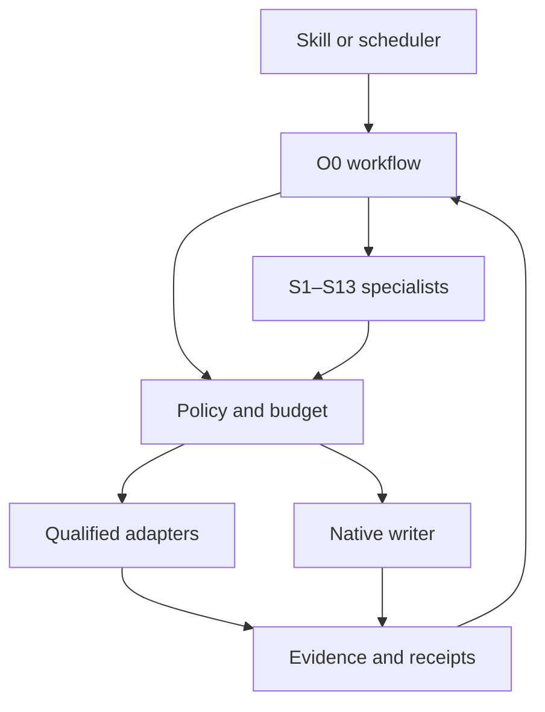

# Architecture and Repository Boundaries

> Historical integration-design baseline, 2026-11-02. See [current public distribution](current-release.md) for shipped components and adopted publication decisions. Proposed runtime behavior remains unimplemented.

This document specifies the future implementation. Only the documentation, catalogs, and design examples listed in the package manifest are delivered now.

## Logical topology

The scheduler supplies a trigger, not additional authority. All adapters receive a policy-scoped request. The native writer can refuse a proposal or require its own approval. Its acceptance is distinct from successful application and from verified live behavior.

## Proposed repository map

| Future path | Responsibility | Source or creation strategy |
|---|---|---|
| `skills/seo-geo/SKILL.md` | Thin skill entry, supported modes, reference navigation | Adapt current skill; remove private defaults |
| `skills/seo-geo/agents/openai.yaml` | Optional host display metadata | Retain only if the supported host format remains current |
| `docs/methodology/` | Canonical workflow, technical/editorial checks, search surfaces, measurement and continuous improvement | Extract generic skill references; deduplicate with agent annexes |
| `agents/COMMON.md` | Shared role behavior and trust boundaries | Consolidate generic current common instructions |
| `agents/profiles/O0.md` and `S1.md`–`S13.md` | Focused role instructions and output contract | Preserve IDs; remove fixed model/tenant bindings |
| `catalog/capabilities.csv` | All 144 scope IDs and their ownership/implementation mapping | Preserve complete source coverage; English descriptions |
| `catalog/agents.csv` | Agent inputs, outputs, dependencies, limits, review boundary | Reconciled O0/S1–S13 |
| `catalog/connector-operations.csv` | Distinct operations and qualification requirements | Normalize the three source inventories |
| `catalog/rules.csv` | Dated method/provider rules and evaluation links | New reviewed registry; no copied vendor manuals |
| `contracts/` | JSON schemas and wire-version rules | Reconcile existing records/finding/capture contracts |
| `crates/seo-geo-contracts/` | Rust contract types/validation | Future implementation from reviewed schemas |
| `crates/seo-geo-policy/` | Mandate, target, operation and budget checks | Future policy boundary outside models |
| `crates/seo-geo-state/` | Durable state, outbox, deduplication and revisions | Future local store; bridge existing native authority |
| `crates/seo-geo-engine/` | Observation-to-proposal workflow and recovery | Reuse or bridge legacy core after inspection |
| `crates/seo-geo-cli/` | Manual and scheduler entry point | Future command interface |
| `adapters/coordination/`, `scheduler/`, `model/` | Optional deployment bindings | Existing private integration becomes a private plugin/profile |
| `adapters/http/`, `wix/`, `gsc/`, `bing/`, `indexnow/` | Operation-specific external integration | Inspect current code before implementing; qualify separately |
| `tools/offline-capture/` | Captured-HTML auditor | Preserve existing Python helper and exit semantics |
| `tools/readiness-observer/` | Local package integrity observer | Extract path, coordinator, and scheduler dependencies |
| `tests/{contracts,offline-capture,policy,recovery,adapters,evaluation}/` | Behavior and compatibility evidence | Fixtures by default; live tests explicitly separated |
| `examples/` | Synthetic project, capture, review and report examples | No operational identifiers or credentials |
| `templates/` | Report, audit, improvement, issue and PR forms | Generic English templates |
| `.github/` | Future checks, contribution and security settings | Maintainer-controlled configuration after readiness review |

The source-file maps specify each archived file's disposition. A path in this proposed map is not evidence that the corresponding software has been built.

## Minimal runtime

One process consumes a bounded work order, obtains policy and budget decisions, collects deterministic evidence, and asks O0 whether specialist analysis would add value. State is committed before acknowledging work. A durable outbox records notifications separately from observations, so observing a change cannot falsely mark its notification as delivered.

Use a single task authority per deployment. Local ledger IDs link to native task IDs rather than replacing the native tracker. For an isolated standalone installation, the local ledger can be that authority. For an existing coordinated installation, its lease and receipt protocol remains authoritative.

No attempt to guarantee exactly-once remote side effects is made. Writes require idempotency when the provider supports it and reconciliation otherwise. Store request, attempted effect, per-item result, and observed current revision. A timeout after a write enters an unknown-outcome state and does not trigger a blind retry.

## State dimensions

Keep these independent:

- Task: queued, observing, diagnosing, proposed, awaiting-review, ready-for-handoff, applying, reconciling, verifying, measuring, closed, blocked, cancelled.
- Content: draft, reviewed, accepted, revoked; translation coverage and acceptance separately.
- Delivery: source-integrated revision, built revision, deployed revision, publicly verified revision.
- Search state: discovery/crawl/index/canonical observations per engine and date.
- Commercial state: price freshness and availability independent of editorial acceptance.
- Outcome: visibility, citation, conversion, cost and uncertainty for a defined cohort/window.

Publication is not a status automatically reached by passing a local test. Temporary price or slot uncertainty must not automatically deindex a still-valid accepted editorial page. A clinical claim change can require re-review of dependent translations without invalidating unrelated commercial facts.

## Version and generation rules

Use a repository release version plus independent contract, method, role-bundle and adapter versions. Breaking record changes increment the contract major version. Additive optional fields require a compatible minor version. Unknown major versions are rejected before execution; old evidence is migrated explicitly and never silently rewritten.

Generated distributions record the exact source commit, catalog/method/contract versions, included files and hashes. CI will fail if regenerated outputs drift. Pin external protocol/provider versions when supported and record the resolved revision when documentation is mutable. A new adapter version does not upgrade a deployment's mandate or qualified capabilities automatically.

## Dependencies and failure isolation

A missing model does not prevent deterministic offline auditing. A failed GSC read does not prevent public HTML inspection. An unavailable commercial source suppresses only dependent fresh-price claims. An unqualified writer leaves a proposal available for review or manual handoff. A revoked mandate stops affected future effects while retaining evidence and accrued cost.

Model outputs, crawled pages, PDFs, issue text, reviews and tool-returned prose are data to validate. They cannot change permissions, choose a new tenant, install software, or rewrite the method. A separate policy layer validates each effect against the work order and current authority.
